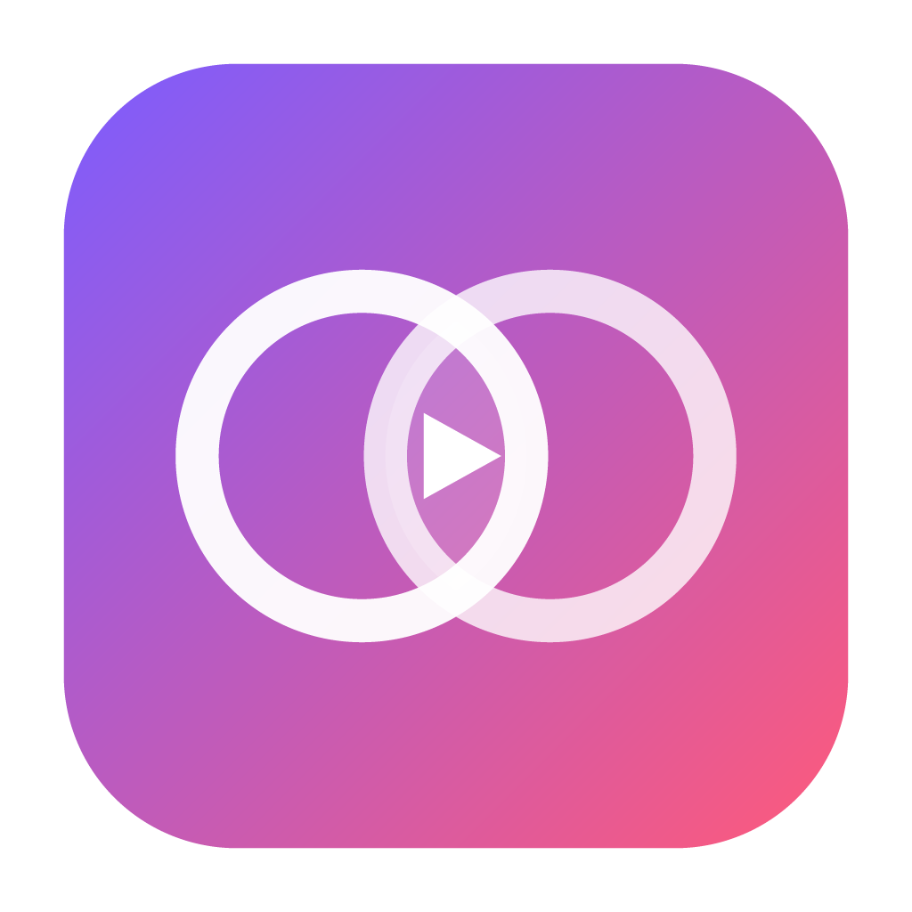

<p align="center">
  
</p>

<h1 align="center">MixMusic</h1>

<p align="center"><strong>Spotify and YouTube Music in one player, shaped the way you like it.</strong></p>

MixMusic is an open-source desktop music player for Windows and Linux. One
search looks through YouTube Music and Spotify at once, one queue mixes
tracks of both, and one library keeps liked songs and playlists that hold
tracks of either service. Its whole look is a theme, and the community adds
themes and plugins to it from a shared registry.

It is a single small Go program built on [MyGo](https://github.com/egoist/mygo):
the interface is a web page in the system's own webview, so there is no
bundled browser to download or keep in memory.

## Features

- **One search, two services.** Results of YouTube Music and Spotify side by
  side, every track marked with where it comes from.
- **One queue.** Play a Spotify track after a YouTube Music one, shuffle and
  repeat across both, and let a radio carry on when the queue runs out.
- **Your mixes.** Playlists that hold tracks of every service, liked songs
  across both, import of a service's playlist into a mix, history and
  listening stats.
- **Spotify your way.** Spotify tracks play on Spotify Connect (your own
  Spotify app, at Spotify's quality), or here, from their recording on
  YouTube Music, with no Premium needed.
- **A real player.** Crossfade, volume levelling, a 10-band equalizer with
  presets, a visualizer, synced lyrics that follow the song, and an offline
  cache of tracks you played.
- **At home on the desktop.** Media keys, tray controls, notifications of new
  tracks, a mini player that stays on top, start at login, `mixmusic://`
  links.
- **Keyboard first.** Shortcuts for everything common, and a command palette
  (<kbd>Ctrl</kbd> <kbd>K</kbd>) for the rest.
- **Themes.** Six built in, options per theme, an accent taken from the
  artwork playing, your own CSS, and community themes one click away.
- **Plugins.** Small ES modules that add pages, commands, track actions and
  widgets through a typed API.

## Install

Download the latest release for your system from
[Releases](https://github.com/fzn0x/mixmusic/releases):

| System | Download |
|---|---|
| Windows 10 and 11 (x64, arm64) | `MixMusic Setup <version> <arch>.exe` |
| Debian, Ubuntu and derivatives | `mixmusic_<version>_<arch>.deb` |
| Any Linux (x64, arm64) | `mixmusic-<version>-linux-<arch>.tar.gz`, with `install.sh` |

### What it needs

- **Windows:** the WebView2 Runtime, which Windows 11 includes.
- **Linux:** GTK 3, WebKitGTK 4.1 and the GStreamer plugins that play Opus
  and AAC audio. On Debian and Ubuntu:

  ```sh
  sudo apt install libwebkit2gtk-4.1-0 gstreamer1.0-plugins-good gstreamer1.0-libav libayatana-appindicator3-1 libsecret-1-0
  ```

  The tray icon needs `libayatana-appindicator3`, and keeping your Spotify
  sign-in in the system's keyring needs `libsecret`; MixMusic works without
  either.
- **To play YouTube Music:** [yt-dlp](https://github.com/yt-dlp/yt-dlp), which
  MixMusic installs for you from Settings › Playback, and a JavaScript runtime
  yt-dlp uses for YouTube: [Deno](https://deno.com), Node.js, Bun or QuickJS,
  on your `PATH`.

### Spotify

Spotify lets each app serve a few users of its owner's choosing, so you sign
in with an app of your own: create one in the
[Spotify developer dashboard](https://developer.spotify.com/dashboard), add the
redirect URI `http://127.0.0.1:47823/callback`, and paste its Client ID in
Settings › Accounts. [docs/spotify.md](docs/spotify.md) walks through it, and
through what Spotify allows apps to do.

## Make it yours

- [Themes](docs/themes.md): the tokens, options and hooks themes style, and how
  to make one.
- [Plugins](docs/plugins.md): the plugin API, with the
  [types](sdk/index.d.ts) for your editor.
- [Share them](community/README.md): add yours to the community registry, and
  everyone can install it from the marketplace.

## Develop

You need [Go](https://go.dev/dl/) 1.27 or later and [Bun](https://bun.sh).

```sh
bun install
bun run dev        # the app, rebuilt as you edit Go, the frontend live
```

```sh
go test ./...                  # the Go side
bun run typecheck              # the frontend
bun run build                  # the packaged app of this system, in build/
bun run build -- -platform windows/amd64,linux/amd64,linux/arm64
go run ./tools/registry -check # the community registry
```

MyGo needs no C toolchain, so any machine builds MixMusic for every system.
[docs/architecture.md](docs/architecture.md) tells how the parts fit, and
[CONTRIBUTING.md](CONTRIBUTING.md) how to send a change.

### Layout

```
main.go              the app: windows, the tray, media keys, deep links
internal/app         the services the interface calls, and the desktop integration
internal/youtube     YouTube Music's catalog
internal/spotify     the Spotify Web API, its sign-in and Spotify Connect
internal/stream      audio streams, found by yt-dlp and served to the player
internal/match       Spotify tracks matched to their YouTube Music recordings
internal/lyrics      synced lyrics
internal/library     liked songs, mixes, history and stats
internal/addons      themes and plugins, and the community registry
builtin/themes       the themes MixMusic ships with
src/                 the interface: Preact, TypeScript and CSS
sdk/                 the types of the plugin API
community/           community themes and plugins, and their registry
```

## Good to know

MixMusic is not affiliated with, endorsed by or sponsored by Spotify or
Google. It plays what these services offer to their users, through the
services' own interfaces; use it as their terms allow. Spotify and YouTube
Music are trademarks of their owners.

## License

[MIT](LICENSE). The Selawik typeface in `src/assets/fonts` is under the
[SIL Open Font License](src/assets/fonts/OFL.txt).
