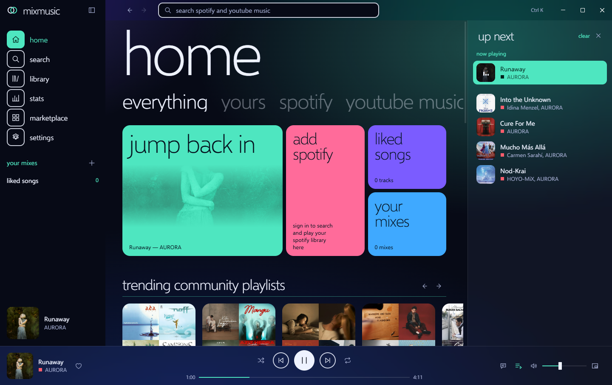

<p align="center">
  
</p>

<h1 align="center">MixMusic</h1>

<p align="center"><strong>Spotify and YouTube Music in one player, shaped the way you like it.</strong></p>

<p align="center">
  <a href="https://fzn0x.github.io/mixmusic/">Website</a> ·
  <a href="https://github.com/fzn0x/mixmusic/releases/latest">Download</a> ·
  <a href="CHANGELOG.md">Changelog</a> ·
  <a href="community/README.md">Themes and plugins</a>
</p>

<p align="center">
  
</p>

MixMusic is an open-source desktop music player for macOS, Windows and Linux. One
search looks through YouTube Music and Spotify at once, one queue mixes
tracks of both, and one library keeps liked songs and playlists that hold
tracks of either service. Its whole look is a theme, and the community adds
themes and plugins to it from a shared registry.

It is a single small Go program built on [MyGo](https://github.com/egoist/mygo):
the interface is a web page in the system's own webview, so there is no
bundled browser to download or keep in memory.

## Features

- **One search, two services.** Results of YouTube Music and Spotify side by
  side, every track marked with where it comes from.
- **One queue.** Play a Spotify track after a YouTube Music one, shuffle and
  repeat across both, and let a radio carry on when the queue runs out.
- **Your mixes.** Playlists that hold tracks of every service, liked songs
  across both, import of a service's playlist into a mix, search and sort
  inside any of them, history and listening stats day by day.
- **Your accounts.** Sign in to YouTube Music, on Google's own page, for
  your home feed, your liked songs, playlists, albums and artists, and the
  audio quality of your account; sign in to Spotify for your library there.
  Like a song, save an album or a playlist, or follow an artist, and it
  reaches the service too.
- **Explore.** New releases, trending songs, the charts, moods and genres,
  and related songs under what plays.
- **Spotify your way.** Spotify tracks play on Spotify Connect (your own
  Spotify app, at Spotify's quality), or here, from their recording on
  YouTube Music, with no Premium needed.
- **A real player.** Crossfade, volume levelling, a 10-band equalizer with
  presets, a visualizer, synced lyrics that follow the song or read as plain
  text, and an offline cache of tracks you played.
- **At home on the desktop.** Media keys and the system's media controls,
  tray controls, notifications of new tracks, a mini player that stays on
  top, start at login, and `mixmusic://` links.
- **Scrobbling and Discord.** Connect Last.fm and every track you hear
  joins your profile there, with scrobbles made offline sent once you are
  back. Your Discord profile shows what plays, with its artwork and the
  time left.
- **Updates.** MixMusic looks for a new release once a day, checks its
  signature, and installs it when you agree, or by itself if you choose.
- **Keyboard first.** Shortcuts for everything common, a key of your own for
  any command, plugins' too, and a command palette
  (<kbd>Ctrl</kbd> <kbd>K</kbd>) for the rest.
- **Themes.** Six built in, options per theme, a theme for the computer's
  light mode and one for its dark mode, an accent taken from the artwork
  playing, your own CSS, and community themes one click away.
- **Plugins.** Small ES modules that add pages, commands, track actions and
  widgets through a typed API.

## Install

Download the latest release for your system from
[Releases](https://github.com/fzn0x/mixmusic/releases):

| System | Download |
|---|---|
| macOS 12 and later (Apple silicon and Intel) | `mixmusic-<version>-macos-universal.dmg` |
| Windows 10 and 11 (x64, Arm) | `mixmusic-<version>-windows-<arch>-setup.exe` |
| Debian, Ubuntu and derivatives | `mixmusic-<version>-linux-<arch>.deb` |
| Any Linux (x64, Arm64) | `mixmusic-<version>-linux-<arch>.tar.gz`, with `install.sh` |

`<arch>` is `amd64` for x64 and `arm64` for Arm. Each release lists
`SHA256SUMS` to verify the downloads with.

### What it needs

- **macOS:** nothing more. The app is not notarized by Apple yet, so the
  first time you open it macOS says it cannot check it. Open it anyway
  from System Settings › Privacy & Security, with Open Anyway, or clear
  the download mark once in Terminal:

  ```sh
  xattr -dr com.apple.quarantine /Applications/MixMusic.app
  ```
- **Windows:** the WebView2 Runtime, which Windows 11 includes. The
  installer is not signed yet, so SmartScreen may warn about it: choose
  More info, then Run anyway.
- **Linux:** GTK 3, WebKitGTK 4.1 and the GStreamer plugins that play Opus
  and AAC audio. On Debian and Ubuntu:

  ```sh
  sudo apt install libwebkit2gtk-4.1-0 gstreamer1.0-plugins-good gstreamer1.0-libav libayatana-appindicator3-1 libsecret-1-0
  ```

  The tray icon needs `libayatana-appindicator3`, and keeping your sign-ins
  in the system's keyring needs `libsecret`; MixMusic works without either.
- **To play YouTube Music:** [yt-dlp](https://github.com/yt-dlp/yt-dlp), which
  MixMusic installs for you from Settings › Playback, and a JavaScript runtime
  yt-dlp uses for YouTube: [Deno](https://deno.com), Node.js, Bun or QuickJS,
  on your `PATH`.

### Spotify

Spotify lets each app serve a few users of its owner's choosing, so you sign
in with an app of your own: create one in the
[Spotify developer dashboard](https://developer.spotify.com/dashboard), add the
redirect URI `http://127.0.0.1:47823/callback`, and paste its Client ID in
Settings › Accounts. [docs/spotify.md](docs/spotify.md) walks through it, and
through what Spotify allows apps to do.

### YouTube Music

YouTube Music plays without an account. To bring your own home feed and
library, choose Sign in to YouTube Music in Settings › Accounts and sign in
to Google in the window that opens. What you type goes to Google alone:
MixMusic keeps the session the window ends with, encrypted with a key in the
system's keyring where there is one.

### Last.fm

Last.fm asks each app for an API account. Create one at
[last.fm/api/account/create](https://www.last.fm/api/account/create), where
any name will do and the callback URL can stay empty. Paste its API key and
shared secret in Settings › Accounts, and approve MixMusic on the page that
opens in your browser. A track counts once half of it played, or four
minutes.

### Discord

Discord shows the name of an application beside what you listen to. Create
one called MixMusic in the
[Discord developer portal](https://discord.com/developers/applications),
turn on Show what plays on Discord in Settings › Desktop, and paste its
application ID there. The Discord app has to be running.

## Make it yours

- [Themes](docs/themes.md): the tokens, options and hooks themes style, and how
  to make one.
- [Plugins](docs/plugins.md): the plugin API, with the
  [types](sdk/index.d.ts) for your editor.
- [Share them](community/README.md): add yours to the community registry, and
  everyone can install it from the marketplace.

## Develop

You need [Go](https://go.dev/dl/) 1.27 or later and [Bun](https://bun.sh) 1.2 or later.

```sh
bun install
bun run dev        # the app, rebuilt as you edit Go, the frontend live
```

```sh
go test ./...                  # the Go side
bun run typecheck              # the frontend
bun run build                  # the packaged app of this system, in build/
bun run build -- -platform windows/amd64,linux/amd64,linux/arm64
go run ./tools/registry -check # the community registry
```

MyGo needs no C toolchain, so any machine builds MixMusic for every system.
[docs/architecture.md](docs/architecture.md) tells how the parts fit, and
[CONTRIBUTING.md](CONTRIBUTING.md) how to send a change.

### Layout

```
main.go              the app: windows, the tray, media keys, deep links
internal/app         the services the interface calls, and the desktop integration
internal/youtube     YouTube Music's catalog, and your account there
internal/spotify     the Spotify Web API, its sign-in and Spotify Connect
internal/stream      audio streams, found by yt-dlp and served to the player
internal/match       Spotify tracks matched to their YouTube Music recordings
internal/lyrics      synced lyrics
internal/library     liked songs, mixes, history and stats
internal/lastfm      scrobbling to Last.fm
internal/discord     what plays, on your Discord profile
internal/addons      themes and plugins, and the community registry
builtin/themes       the themes MixMusic ships with
src/                 the interface: Preact, TypeScript and CSS
sdk/                 the types of the plugin API
community/           community themes and plugins, and their registry
```

## Good to know

MixMusic is not affiliated with, endorsed by or sponsored by Spotify or
Google. It plays what these services offer to their users, through the
services' own interfaces; use it as their terms allow. Spotify and YouTube
Music are trademarks of their owners.

## License

[MIT](LICENSE). The Selawik typeface in `src/assets/fonts` is under the
[SIL Open Font License](src/assets/fonts/OFL.txt).
